  

 

  &nbsp;
  &nbsp;
  &nbsp;
  &nbsp;
  

### 👨‍💻 About Me

Full Stack Developer with about two years of professional experience building enterprise platforms, SaaS tools, and production web applications with React, Next.js, Node.js, and TypeScript.

- 💼 &nbsp; **Groupe Chiali**: built an internal Document Management System and a production management platform (GPAO), deployed with multi-container Docker on Linux
- 🛒 &nbsp; Built and operate **[Paradise Game DZ](https://paradisegamedz.com)**, a live commerce platform serving ~7.5K weekly active users
- 🔐 &nbsp; Focus on secure API design (RBAC, JWT, OAuth), bilingual French/Arabic (RTL) interfaces, and real-time systems
- 🎓 &nbsp; B.Sc. Computer Science, Université Djillali Liabès (2020–2023)
- 🌱 &nbsp; Currently deepening: automated testing, CI/CD, and system design
- 📬 &nbsp; Open to full-stack roles: remote, hybrid, or relocation

### 🛠️ Tech Stack

**Frontend**

**Backend & Database**

**Tools & DevOps**

### 🚀 Featured Projects

| Project | What it is | Stack |
|---|---|---|
| **[Paradise Game DZ](https://paradisegamedz.com)** | Production commerce platform (~7.5K weekly active users): real-time order chat, multi-currency pricing, promotions, reviews, RBAC, bilingual FR/AR with RTL | Next.js, TypeScript, Supabase, PostgreSQL, Cloudflare R2 |
| **[PlugNPretty](https://plugnpretty.com)** | Bilingual e-commerce platform: catalog with variants and promotions, guest and authenticated checkout, admin back office, SEO | Next.js, TypeScript, Supabase, Tailwind CSS |
| **[LazyQuery](https://lazy-query.online)** | Open-source tool that converts SQL/JSON/Prisma schemas into interactive ERD diagrams | React, TypeScript, React Flow, Dagre, Vite |
| **[Pyramid Documentary](https://github.com/sarimAbdelbari/Pyramid-Documentary)** | Full-stack CMS for ISO documentation management | React, Node.js, MongoDB |
| **[Fikrat.tech](https://www.fikrat.tech/)** | Digital studio website for startup and business clients | Next.js, TypeScript, Framer Motion |
| **[VitaLife Medical](https://www.vitalife-medical.dz/)** | Corporate medical website with responsive design and SEO | Next.js, Tailwind CSS |

### 📊 GitHub Stats

  
  &nbsp;&nbsp;
  

  💡 Open to full-stack roles and freelance collaborations. <a href="mailto:sarimabdelbari@gmail.com">Let's talk</a>

